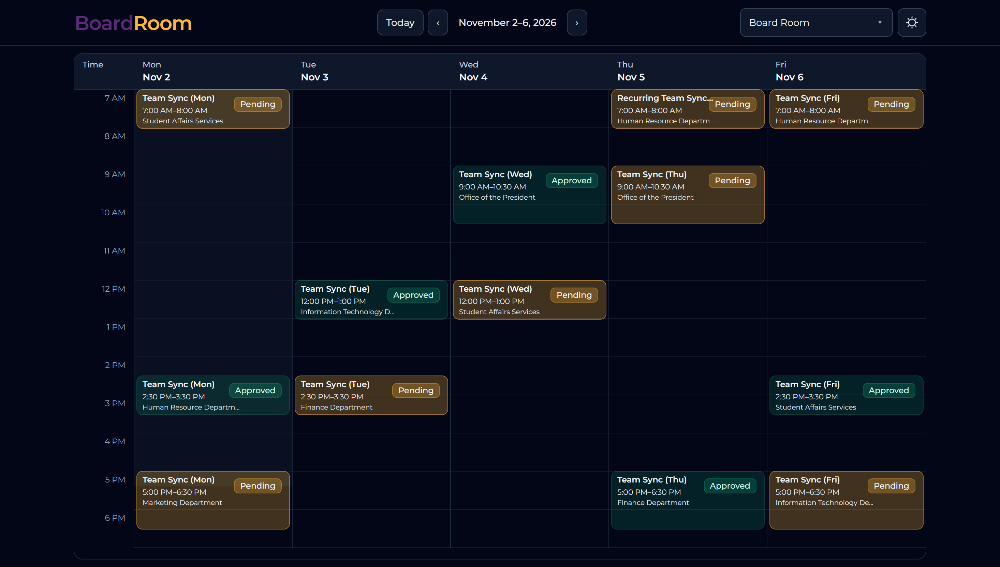

<p align="center">
  
</p>

<h1 align="center">BoardRoom</h1>

<p align="center">
  A straightforward way to see room availability, request a meeting, and keep approvals moving.
</p>

<p align="center">
  
  
  
  
</p>

BoardRoom is a meeting-room scheduling app with a shared weekly calendar, reservation requests, approval workflows, and an admin area for managing access. The interface is built with React and served by Laravel; reservation times use the configured application timezone (Asia/Manila by default).

## What you can do

- Browse a weekday calendar and check pending or approved reservations by room.
- Request, edit, reschedule, or cancel a reservation, including recurring schedules.
- Prevent overlapping bookings and review conflicts before approving a request.
- Approve or reject requests in the app or from signed links in email.
- Manage users, roles, permissions, and reservation history in the admin area.
- See reservation and user changes update through server-sent events, with periodic refresh as a fallback.
- Sign in with Microsoft, optionally restrict sign-in to specified email domains, and send approval/status emails through SMTP.

## Stack

- **Backend:** PHP 8.2+, Laravel 12
- **Frontend:** React 19, Vite 7, Tailwind CSS
- **Database:** SQLite by default; MySQL is supported
- **Authentication:** Microsoft OAuth 2.0 sign-in
- **Email and queue:** Laravel mail and database queue by default

## Run locally

### Requirements

PHP 8.2 or newer with the PDO driver for your database, Composer, Node.js and npm, and SQLite or MySQL.

1. Install PHP and JavaScript dependencies:

   ```sh
   composer install
   npm install
   ```

2. Create your environment file and application key:

   ```sh
   cp .env.example .env
   php artisan key:generate
   ```

   On Windows PowerShell, use `Copy-Item .env.example .env` in place of `cp`.

3. Configure the database in `.env`. The example uses SQLite. Create the file if needed:

   ```sh
   touch database/database.sqlite
   ```

   For PowerShell: `New-Item database/database.sqlite -ItemType File`. For MySQL, set `DB_CONNECTION=mysql` and provide `DB_HOST`, `DB_PORT`, `DB_DATABASE`, `DB_USERNAME`, and `DB_PASSWORD`.

4. Apply migrations and optionally load sample data:

   ```sh
   php artisan migrate
   php artisan db:seed
   ```

   The seeders create a Board Room, demo users, and sample reservations. Seeded accounts use `password`; use this only in a local development database and never expose it on a public deployment.

5. Build assets and start the application:

   ```sh
   npm run build
   composer run dev
   ```

   The `dev` script starts Laravel, Vite, a queue listener, and the log viewer. Alternatively, run `php artisan serve` and `npm run dev` in separate terminals.

Open the URL printed by Laravel (typically `http://localhost:8000`). The root route redirects to `/kiosk`; authenticated users can open `/admin`.

## Configuration

Set `APP_NAME`, `APP_URL`, and `APP_TIMEZONE` for your environment. The example timezone is `Asia/Manila`; meeting room records may also define a timezone.

### Microsoft sign-in

Register an application in Microsoft Entra ID and configure its callback URL as `${APP_URL}/auth/microsoft/callback`. Set these values in `.env`:

```dotenv
MICROSOFT_TENANT_ID=common
MICROSOFT_CLIENT_ID=
MICROSOFT_CLIENT_SECRET=
MICROSOFT_REDIRECT_URI="${APP_URL}/auth/microsoft/callback"
MICROSOFT_ALLOWED_DOMAINS=example.com,example.org
```

The allowed-domain list is optional; leave it empty to avoid domain filtering. Microsoft accounts are matched to users by email, so provision users and admin permissions in advance.

### Email and queues

Approval requests go to approvers and reservation status updates go to the requester. Configure SMTP using the `MAIL_*` values in `.env`. For Microsoft 365 SMTP, a typical setup uses `MAIL_HOST=smtp.office365.com`, `MAIL_PORT=587`, and `MAIL_ENCRYPTION=tls`; the mailbox may need authenticated SMTP enabled. Set `APP_URL` to the public application URL so signed email actions point to the right host.

The example uses the database queue. Run a worker to process queued mail:

```sh
php artisan queue:work
```

For small local setups, `QUEUE_CONNECTION=sync` sends jobs immediately.

### Demo admin sign-in

The demo admin endpoint is enabled by default when `APP_ENV=production`, and disabled in other environments. Use it only on a controlled demo deployment, make sure the configured email belongs to an existing admin account, and set `DEMO_ADMIN_LOGIN_ENABLED=false` in Render to disable it:

```dotenv
DEMO_ADMIN_LOGIN_ENABLED=true
DEMO_ADMIN_EMAIL=admin@example.com
```

## Docker

Build and run the included image with Docker. The container listens on port `10000` (or `$PORT`) and expects its environment and database connection to be provided at runtime.

```sh
docker build -t boardroom .
docker run --env-file .env -p 10000:10000 boardroom
```

The Docker startup command applies pending migrations before starting the web server. It does not reset or seed the database. For a Render demo login, set `DEMO_ADMIN_LOGIN_ENABLED=true` and `DEMO_ADMIN_EMAIL` to the email of an existing admin account in Render's environment settings. Keep this disabled on deployments where demo access is not intended.

## Useful commands

| Command | Purpose |
| --- | --- |
| `composer run dev` | Start the Laravel, queue, logs, and Vite development processes |
| `npm run build` | Build production frontend assets |
| `php artisan migrate` | Apply pending database migrations |
| `php artisan db:seed` | Add the sample room, users, and reservations |
| `php artisan queue:work` | Process queued jobs, including email |
| `composer test` | Run the Laravel test suite |

## Project layout

```text
app/                 Laravel controllers, models, mail, and domain support
database/            Migrations, factories, and seeders
resources/js/        React application and UI components
resources/views/     Laravel shell and email templates
routes/web.php       Page, authentication, API, and stream routes
public/images/       Public images, including the README banner
```

## License

This project is distributed under the MIT License, as declared in `composer.json`.
